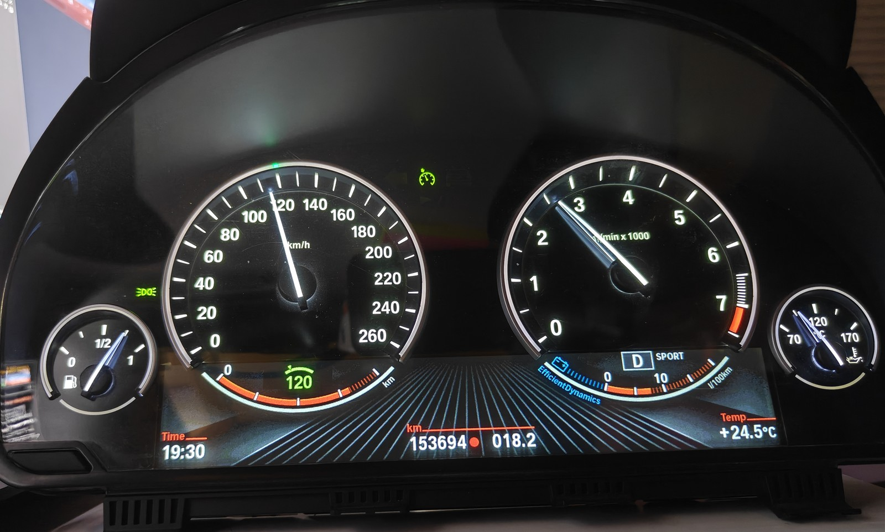
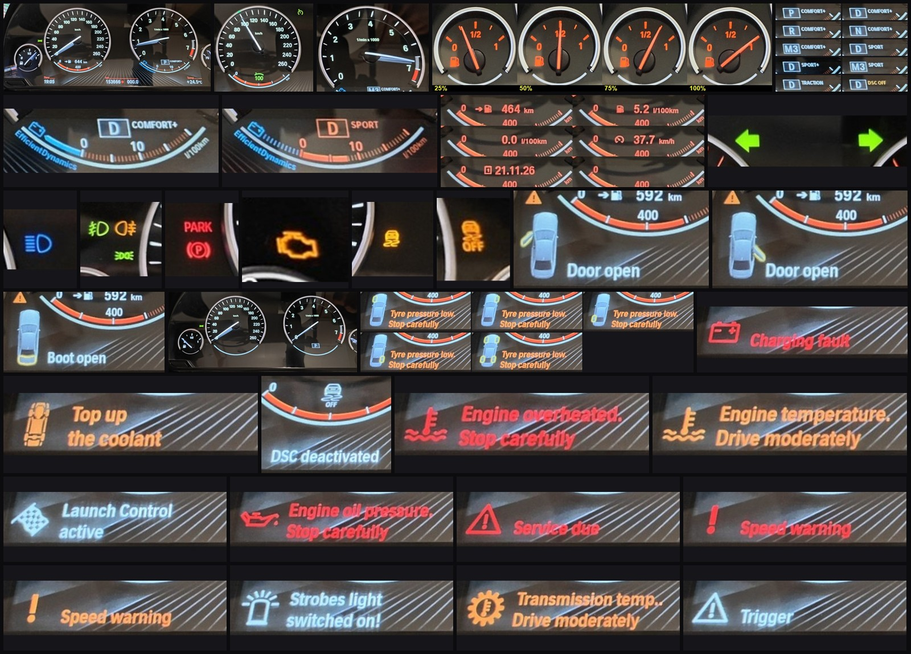

# BMW F-series cluster Arduino project

Drives a real BMW F-series instrument cluster from a PC, for use in driving games. A spinoff of [e90-can-cluster](https://github.com/veikkos/e90-can-cluster), which documents the PC side: the proxy and the BeamNG plugin. The binary serial protocol is documented in the [proxy](https://github.com/veikkos/e90-can-cluster-proxy#binary-serial-protocol).

Developed on an F01/F02 (7 series) cluster, part number 9312035, with an ESP32. Other F-series clusters may behave differently.

_Click the image to see the gallery_

## Features

- Speedometer, odometer, RPM, fuel gauge, range, and instant and average consumption
- Gear and drive mode (COMFORT+, SPORT, SPORT+, TRACTION, DSC OFF)
- Lights, indicators, handbrake, doors and boot
- DSC and traction control lamps and messages
- Cruise control with the set speed
- EfficientDynamics energy recovery
- On-board computer (BC) button
- Time and date
- Warning symbols, see the [gallery](gallery)

Not yet supported: the adaptive cruise control display.

Known limitations:

- "Service indicator not available" shows at ignition on, the cluster misses its CAS backup.
- The cluster warns above 120 km/h. It is coded into this cluster.

## Differences from e90-can-cluster

- The CAN bus runs at 500 kbit/s and many frames carry a CRC and an alive counter.
- Only the MCP2515 and ESP32 TWAI adapters are supported, see [config.h](config.h).
- The [binary protocol](https://github.com/veikkos/e90-can-cluster-proxy#binary-serial-protocol) is the same. The fields marked F02 in its description are used only here.
- SimHub is not supported, only the binary protocol.

## Credits

- [r00li/CarCluster](https://github.com/r00li/CarCluster)
- [fatihcesur/bmw-f30-cluster-simhub](https://github.com/fatihcesur/bmw-f30-cluster-simhub)
- [damienmaguire/BMW-F11-EV-Conversion](https://github.com/damienmaguire/BMW-F11-EV-Conversion)
- [superwofy/E9X-M-CAN-Integration-Module](https://github.com/superwofy/E9X-M-CAN-Integration-Module)
- [F10 cluster bench write-up on DRIVE2](https://www.drive2.ru/l/716429133348870019/)
- [emdzej/ediabasx-docs-sgbd](https://emdzej.github.io/ediabasx-docs-sgbd/)
- The `M5_F10` firmware, author unknown
- [e90-can-cluster](https://github.com/veikkos/e90-can-cluster#notes-and-findings) and its credits
